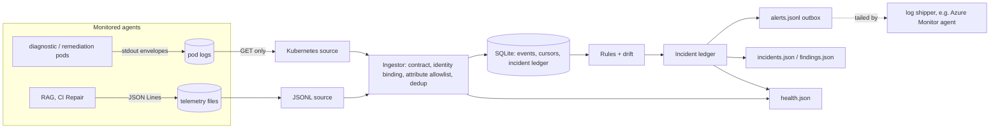

# Agent Monitor II

[](https://github.com/JeanneBM/observability-monitor-agent-II/actions/workflows/ci.yml)

A read-only monitor for AI-agent telemetry. It watches what agents **did** (tool calls,
approvals, token use, claims and their verification, citations, escalations) and raises
incidents when that contradicts policy, instead of trusting what the agents **say** they did.

This is a second, independent implementation of the idea behind
[observability-monitor-agent](https://github.com/JeanneBM/observability-monitor-agent),
written by Claude after a review of the first PoC. The wire format of the telemetry is
unchanged, so emitters in the AKS Agentic Ops, Foundry RAG and LangGraph CI Repair
projects work with both. [What changed and why](#what-changed-compared-with-v1).

```
$ agentmon watch --config sources.json --state state/
INFO agentmon opened high citation_mismatch citation_mismatch|rag|q1|answer:q1-00003
INFO agentmon opened critical unapproved_action unapproved_action|remediation|r1|tool:kubectl_patch

$ agentmon incidents --state state/
#1    open     high     citation_mismatch       rag                 1 citation(s) not in the retrieved set, e.g. 'd9'
#2    open     critical unapproved_action       remediation         'kubectl_patch' called 1x without policy_authorized
```

## Design

- **Read-only by construction.** The Kubernetes client has a single `get` method and refuses
  every API path except pod list/get and pod logs in the configured namespace, before any
  request leaves the process. RBAC is the second line, not the only one.
- **Telemetry in, not conclusions.** Records are validated against a strict contract, bound
  to the identity of the source they came from (a pod cannot speak for another agent), and
  reduced to an allowlist of attributes. Raw tool arguments never exist in the telemetry,
  only keyed fingerprints. Rejected records are counted by reason code, never stored.
- **Deterministic detection.** Every rule is a pure function of a run and the policy: no
  model, no network. An optional LLM only summarises findings for humans, sees sanitised
  findings and never raw traffic, and the deterministic report is produced if it fails.
- **Incidents, not alert spam.** A finding has a stable key that identifies the condition,
  not its wording. Incidents open, update in place, resolve after a quiet period
  (hysteresis), and **reopen as new incidents when a problem recurs**.
- **Fail loud.** A missing source, a truncated read, an expired credential or an agent pod
  that disappeared are incidents. "No findings" never means "could not look".
- **The monitor is evaluated like the agents.** Anomalies are hidden in realistic background
  traffic, next to negative controls placed exactly at the limits, and scored per rule.



The monitor makes no outbound calls apart from its read-only sources: alerts are written to
an append-only outbox that a log shipper forwards. Delivery is at-least-once (the outbox is
fsynced before the state commit).

## Rules

| Rule | Severity | Detects |
|---|---|---|
| `permission_violation` | critical | tool call outside the agent's allowlist |
| `unapproved_action` | critical | approval-gated tool called without a preceding `policy_authorized` (one approval grants one call; `policy_denied` revokes) |
| `unknown_agent` | high | telemetry from an agent with no policy entry (one incident per agent) |
| `unverified_claim` | high | `fixed` claim in a finished run with no verification (in-flight runs are pending) |
| `claim_contradicted` | high | `fixed` claim whose verification did not return `ok` (matched by `claim_id`) |
| `ungrounded_answer` | high | answer without any retrieval results |
| `citation_mismatch` | high | answer citing nothing, or citing sources it did not retrieve |
| `run_failed` | high | run finished with status `error` |
| `run_stalled` | high | run without a terminal event past its idle timeout |
| `tool_loop` | medium | same tool with the same arguments beyond the limit (calls without `args_hash` count as identical) |
| `budget_exceeded` | medium | tokens, cost, tool calls or duration per run above the limit |
| `behavior_drift` | medium | escalation rate (Fisher exact test) or tool calls per run (Welch z-test) of the latest N runs significantly above the baseline |
| `run_integrity` | low | events recorded after the run's terminal event |

Collection problems are incidents too:

| Rule | Severity | Detects |
|---|---|---|
| `source_unavailable` | high | a source cannot be read (missing file, forbidden, expired credential, ...) |
| `source_identity_mismatch` | high | a record claims an agent identity its source is not bound to |
| `event_id_collision` | high | an event id reused for different data |
| `agent_missing` | high | an expected agent has no pod behind the selector |
| `invalid_telemetry` | medium | records rejected by the contract, counted per reason code |
| `collection_error` | medium | part of a source (one pod) could not be read this cycle |
| `collection_truncated` | medium | a read hit its size limit |
| `agent_unhealthy` | medium | an agent pod is not ready |
| `credential_expiring` | low | the collector credential expires within 24 h |

Limits are per agent in [`examples/policy.json`](examples/policy.json). The policy is
validated strictly: an unknown key fails with a suggestion (`did you mean 'allowed_tools'?`),
and an approval-gated tool must also be an allowed tool.

## Quick start

```bash
pip install -e ".[dev]"
pytest

agentmon eval                                        # evaluation on 20 seeds
agentmon generate --out sample/                      # sample telemetry + baseline
agentmon analyze sample/M10.jsonl --policy examples/policy.json
agentmon analyze sample/M13.jsonl --policy examples/policy.json --baseline sample/baseline.json --json
agentmon validate --policy examples/policy.json --config examples/sources.json
```

`analyze` exits with 1 when a finding is at least `--fail-on` severe (default `high`), so it
can gate a pipeline. `--llm` adds an Azure OpenAI triage summary (`pip install -e ".[llm]"`,
`AZURE_OPENAI_ENDPOINT`, `AZURE_OPENAI_DEPLOYMENT`, Entra ID / Workload Identity, no keys).

## Continuous monitoring

```bash
agentmon watch --config examples/sources.json --state state/ --interval 5
agentmon incidents --state state/ [--all] [--json]
agentmon incidents --state state/ --ack 2 --by joanna   # human acknowledgement
agentmon health --state state/ --max-age 60             # exit code for probes
```

```json
{
  "instance": "local-lab",
  "policy": "policy.json",
  "baseline": "baseline.json",
  "retentionHours": 24,
  "incidentResolveCycles": 2,
  "sources": [
    {"type": "jsonl", "name": "rag", "path": "../telemetry/rag.jsonl", "agent": "rag"},
    {"type": "kubernetes", "name": "aks", "namespace": "agentic-ops",
     "selector": "app=agentic-ops", "agentLabel": "role",
     "expectedAgents": ["diagnostic", "remediation"],
     "transport": "kubectl", "kubeconfig": "readonly-kubeconfig.yaml",
     "credentialExpiresAt": "2026-12-31T00:00:00Z"}
  ]
}
```

Relative paths resolve against the config file. The worker stops cleanly on `SIGTERM`,
`SIGINT` or a `stop` file in the state directory, and exits non-zero after five consecutive
failed cycles. State directory:

| File | Content |
|---|---|
| `events.sqlite` | deduplicated events, per-source cursors, incident ledger (WAL, migrated by `user_version`) |
| `findings.json` | every condition detected in the latest cycle |
| `incidents.json` | open incidents |
| `alerts.jsonl` | append-only outbox of `opened` / `escalated` / `resolved` transitions |
| `health.json` | heartbeat, cycle time, per-source status, per-agent coverage, open incidents by severity |

**JSONL source.** Cursor = device, inode, offset and a digest of the first bytes, so both
rename rotation and copy-truncate are detected; replays are safe because ingestion is
idempotent. A partial last line waits for the writer. A line longer than `maxLineBytes` is
skipped up to its newline and reported, so one bad record cannot block the source.

**Kubernetes source.** Label selector, agent label and expected agents are configuration.
Logs are read per container with a per-container cursor and a configurable overlap; previous
logs are fetched only for a container that actually restarted. A failure on one pod degrades
the source without blinding it, and that pod's window is retried. Two transports, both GET
only: `kubectl get --raw` with a scoped kubeconfig, or `in-cluster` HTTPS with the projected
ServiceAccount token (re-read on every request, TLS verified against the cluster CA).

## Kubernetes deployment

[`deploy/kubernetes`](deploy/kubernetes) (`kubectl apply -k deploy/kubernetes`):

- the monitor runs in its own namespace `agentmon` with Pod Security `restricted` enforced;
- a `Role` in the agents' namespace grants `get`/`list` on pods and `get` on `pods/log`,
  nothing else; no access to its own namespace;
- non-root, read-only root filesystem, all capabilities dropped, seccomp `RuntimeDefault`;
- a projected, audience-bound token with a one-hour lifetime instead of the legacy automount;
- a `NetworkPolicy` with no ingress, egress only to DNS and the API server ports;
- a single replica with `Recreate` (one SQLite writer) on a persistent volume;
- liveness = heartbeat freshness (`agentmon health`), not source health: a degraded source
  is an incident, not a reason to restart.

## Telemetry contract

One JSON object per line, or per log line inside `{"agent_monitor_event": {...}}`:
`id, ts, agent, run_id, type` and optional `tool, args_hash, tokens, cost_usd, latency_ms,
status, citations, retrieved, attrs`. Types: `run_started, tool_call, llm_call, escalation,
claim, verification, answer, policy_authorized, policy_denied, run_finished`.
Details and limits: [docs/telemetry-contract.md](docs/telemetry-contract.md).

A reference emitter ships with the package:

```python
from agentmon.emitter import JsonlSink, LogSink, Telemetry

telemetry = Telemetry("remediation", LogSink(), args_key=secret)   # or JsonlSink(path)
with telemetry.run() as run:                       # run_finished is always emitted,
    run.tool("acr_check", {"image": image})        # status "error" if the block raises
    run.authorized("kubectl_patch", approver="oncall")
    run.tool("kubectl_patch", {"deployment": name})
    run.claim("fixed", claim_id="c1")
    run.verify("ok", claim_id="c1", verifier="rollout-check")
```

## Evaluation

`agentmon eval` hides each anomaly among 30 clean runs per agent and compares the produced
finding keys with the expected ones exactly: a miss is a false negative, any extra key is a
false positive. Every scenario runs with a drift baseline, so drift detection is exposed to
clean traffic too. There are 25 scenarios: one clean (C00), seven negative controls
(N01 to N07: a loop exactly at the limit, two approved patches, an in-flight claim, a valid
abstention, tokens exactly at the budget, a small rise in escalations, too few runs for a
verdict) and seventeen anomalies (M01 to M17).

The verdict is deliberately split. Deterministic rules must be exact on every seed.
Statistical drift detection has an irreducible false-alarm rate on random traffic, so it is
judged by precision and recall over at least 10 seeds. Current result on 20 seeds:

| Rule | TP | FP | FN | Precision | Recall |
|---|---:|---:|---:|---:|---:|
| all 12 deterministic rules | 300 | 0 | 0 | 1.00 | 1.00 |
| `behavior_drift` (statistical) | 40 | 3 | 0 | 0.93 | 1.00 |

The three drift false alarms are windows in which 7 or 8 of the last 20 runs escalated at a
true rate of 10%, against a baseline sample that happened to come out at 3 to 5%. The
evaluation found two design flaws while this was being built: the normal approximation was
far too optimistic for windows of 15 to 20 runs (now Fisher's exact test), and comparing the
whole 24 h window diluted sudden jumps (now the latest `drift.window_runs` runs).

## Verification

| Check | Where |
|---|---|
| ruff (incl. bandit rules), ruff format, mypy `--strict` | CI `lint` |
| 179 tests on Python 3.11 to 3.14, branch coverage at least 90% (currently 95%) | CI `test` |
| evaluation on 20 seeds, report uploaded as an artifact | CI `evaluate` |
| manifests rendered and validated with kubeconform `-strict` | CI `kubernetes` |
| live kube-apiserver + etcd (envtest): manifests accepted, RBAC matrix, both transports with a real ServiceAccount token, TLS verification, local path guard | CI `kubernetes`, [`scripts/apiserver-smoke.sh`](scripts/apiserver-smoke.sh), [evidence](evidence/apiserver-smoke-2026-11-12.md) |
| image builds, runs as UID 10001 with a read-only filesystem | CI `image` |
| kind: image + restricted PSA + in-cluster transport + real pod logs, expects exactly the injected violation | [`kind-smoke`](.github/workflows/kind-smoke.yml), manual and weekly |

Every action is pinned to a commit SHA, downloaded binaries are checked against SHA-256
checksums, and workflows run with `contents: read` only. Dependabot updates actions, Python
dependencies and the base image.

## What changed compared with v1

| v1 behaviour | v2 |
|---|---|
| alert fingerprint included the message: a recurring outage alerted once ever, an ongoing drift created a new alert row every few runs | stable keys, incident lifecycle with hysteresis, recurrence opens a new incident, severity escalation is a transition |
| one line over 64 KB made a JSONL source unavailable on every following cycle | the record is skipped up to its newline and reported |
| `policy_authorized` from the AKS producer was rejected | part of the contract, plus `policy_denied` and the `unapproved_action` rule |
| calls without `args_hash` were invisible to loop detection | counted as identical |
| Kubernetes selector, roles and both-roles-required were hard-coded; one shared cursor for all clusters; `--previous` with `--all-containers` | configuration; per-container cursors per source; previous logs per restarted container only; a missing agent degrades instead of blinding the source |
| drift: thresholds on the whole window | rolling window, Fisher exact / Welch tests plus minimum effect size |
| policy typo: raw `TypeError` | strict validation with suggestions, for policy and config |
| unsalted 10-hex SHA-1 argument hashes | SHA-256, HMAC with a producer key recommended |
| evaluation: one synthetic run per rule, extras ignored | anomalies in background traffic, negative controls at the limits, exact key matching, per-rule precision and recall over seeds |
| `kubectl` only | GET-only `kubectl get --raw` or in-cluster HTTPS, both behind a path guard |

[`tests/test_v1_regressions.py`](tests/test_v1_regressions.py) reproduces each of the
review's probes and asserts the corrected behaviour.

## Limitations

- Telemetry is not tamper-proof. The agents' instrumentation and the source credentials are
  part of the trust boundary; the monitor detects contradictions in what was emitted, not
  actions that were never emitted. An agent that emits nothing is visible only as an idle
  agent or a missing pod.
- Citation membership does not prove that an answer is true.
- Token usage is taken from the provider where reported; missing usage and dollar costs are
  not estimated (`health.json` reports token coverage per agent).
- Drift tests run every cycle; `drift.significance` bounds the false-alarm rate per agent per
  evaluation, not per day. The tool-call test is a large-sample approximation.
- The collector polls. Log rotation on the node, `limitBytes` and host downtime can lose
  telemetry; truncation is reported, gaps during downtime are not reconstructed.
- One replica with SQLite: this is a lab-to-small-production design, not a telemetry bus.

## Layout

```
src/agentmon/
  schema.py        telemetry contract, findings, argument fingerprints
  policy.py        strictly validated per-agent policy
  runs.py rules.py engine.py   run grouping, deterministic rules, analysis
  drift.py         rolling-window drift, Fisher exact and Welch tests, baselines
  incidents.py     incident ledger: lifecycle, hysteresis, acknowledgement
  store.py         SQLite state with migrations
  collect/         ingestion path, JSONL source, GET-only Kubernetes source
  config.py worker.py cli.py   configuration, continuous worker, CLI
  emitter.py       reference producer for monitored agents
  triage.py        optional, sanitised LLM summary with offline fallback
  evaluation/      synthetic traffic, scenarios, scoring
deploy/kubernetes/ hardened manifests (kustomize)
deploy/kind/       fixture agents for the kind smoke
scripts/           live kube-apiserver smoke test
tests/             pytest suite, including v1 regressions
```

## License

MIT
